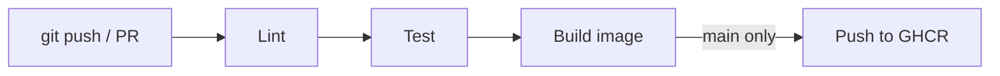
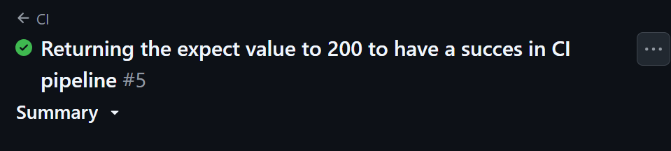
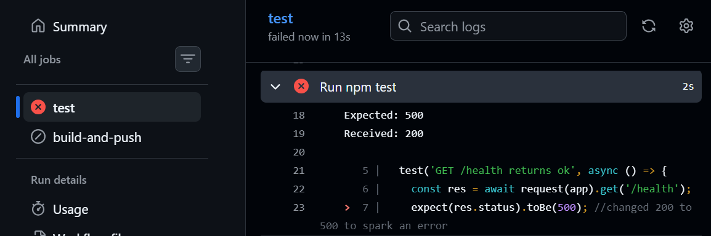
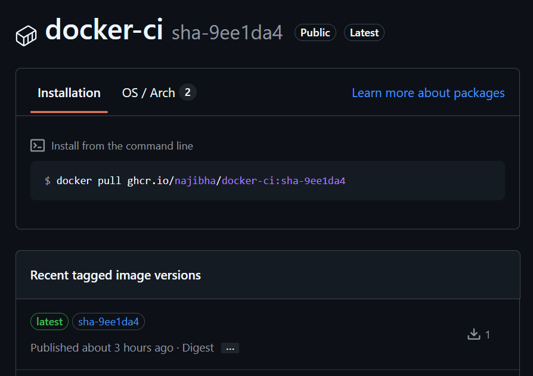
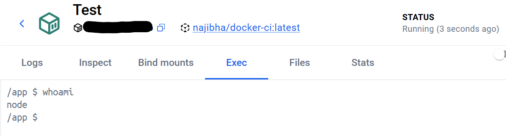

# docker-ci


A small Node.js (Express) todo API, containerized with a multi-stage Docker build and shipped by a GitHub Actions pipeline that lints, tests, builds, and publishes the image to GitHub Container Registry (GHCR).

## Pipeline



- **Pull requests:** lint, test, and build only. Nothing is published.
- **Push to `main`:** the image is also pushed to `ghcr.io/najibha/docker-ci` with two tags: `latest` and `sha-<commit>`.

## Run it

```bash
docker run -it --rm -p 3000:3000 ghcr.io/najibha/docker-ci:latest
curl localhost:3000/health
```

Or run it locally without Docker:

```bash
npm ci
npm run lint
npm test
npm start
```

## API

| Method | Path     | Description        |
|--------|----------|--------------------|
| GET    | /health  | Health check       |
| GET    | /todos   | List todos         |
| POST   | /todos   | Create a todo      |

## Screenshots

| Passing pipeline | Failing PR (broken test) |
|---|---|
|  |  |

| GHCR package with SHA tags | Container running as non-root |
|---|---|
|  |  |

## Design decisions

- **Multi-stage build:** dependencies are installed in one stage and only the runtime files are copied into the final image, so it's smaller and has no dev tooling.
- **Non-root user:** the container runs as `node`, which limits the damage if the app is ever compromised.
- **SHA tags:** every image is traceable to the exact commit that produced it, and unlike `latest` it never changes.
- **`needs: test` gate:** an image is only built and published if lint and tests pass.
- **No stored credentials:** the pipeline authenticates to GHCR with the auto-generated `GITHUB_TOKEN`, and the job permissions follow least privilege.
- **Build cache:** `type=gha` caching speeds up repeat builds.

## Learning value

- **Multi-stage builds:** separating dependency installation from the runtime image keeps the final image small and free of dev tooling.
- **CI gating:** with `needs: test`, an image is only built and published if lint and tests pass. I proved it by breaking a test on purpose in a pull request and watching the pipeline block the build.
- **Immutable tags:** `sha-<commit>` tags make every image traceable to the exact commit that produced it, unlike `latest`, which moves.
